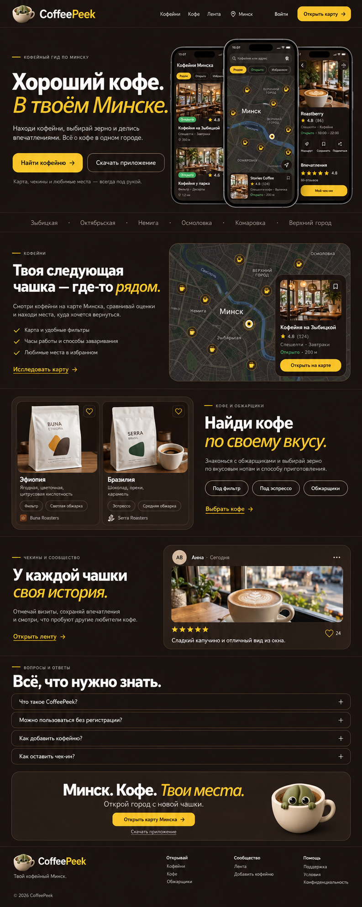

# CoffeePeek — референс компоновки по Roasters

Дата: 21 октября 2026 года.
Источник композиции: https://roasters.app/
Генерация: встроенный imagegen, режим ui-mockup.



## Решение

- Крупный заголовок слева, три перекрывающихся экрана справа.
- Чередующиеся секции «Кофейни», «Кофе и обжарщики», «Чекины и сообщество», затем FAQ, призыв открыть карту и подвал.
- Один город — Минск; русский интерфейс; без переключателей города и языка.
- Существующие цвета CoffeePeek: фон #1A1412, поверхности #2D241F, границы #3D2F28, акцент #EAB308, основной текст #FFFFFF, вторичный #A39E93.
- Фирменный маскот взят из public/logo/logo.png.

Это растровый визуальный референс. Карта, фотографии, названия, оценки и чекины внутри изображения демонстрационные. Генерация приблизительно воспроизводит цвета и типографику. Локальная адаптивная реализация находится в src/pages/LandingPage.tsx и LandingPage.css: она использует цвета и компоненты действующей дизайн-системы и реальные данные API. Отдельный растровый мобильный референс не создавался.

После комментариев к локальной странице первый экран использует предоставленные пользователем скриншоты приложения в рамках iPhone: shops, map и feed, каждый в светлом и тёмном варианте (public/images/app-screenshots/). Скачивание открывается в модальном окне / bottom sheet с QR-кодом, нижние блоки объединены, а подвал разделён на четыре колонки. Недоступность App Store сохраняется по конфигурации API.

## Полный промпт

```text
Use case: ui-mockup.
Asset type: a high-fidelity full-page DESKTOP WEBSITE DESIGN REFERENCE for the existing CoffeePeek coffee discovery service.
Primary request: The user wants the SAME PAGE COMPOSITION as https://roasters.app/ but preserving their existing CoffeePeek colors. One city only: Minsk. One language: Russian.
Input images in chronological order: image 1 is the Roasters homepage HERO screenshot, use only as a COMPOSITION reference (left large editorial title and right three overlapping phones). Image 2 is the Roasters next-section screenshot, use as an ALTERNATING TWO-COLUMN SECTION COMPOSITION reference. Image 3 is the existing CoffeePeek mascot-in-a-cup LOGO, preserve this brand identity faithfully at small scale in header and footer. These are references, NOT images to edit directly.

OUTPUT: One exceptionally polished, coherent long desktop website page, approximately 1440px wide by 3200px tall, front-on flat UI screenshot, edge-to-edge, no browser chrome, no perspective, no surrounding presentation board or annotations. Prioritize readable Cyrillic text and real usable webpage hierarchy. It should look like a senior product designer re-composed Roasters for CoffeePeek, not a generic portfolio collage. Do not display swatches, pixel specifications, wireframe numbers, or design commentary inside the page.

PRESERVE EXISTING PALETTE STRICTLY:
Entire page background #1A1412 warm espresso brown; cards/surfaces #2D241F; thin borders #3D2F28; primary text #FFFFFF; secondary text #A39E93; accent gold #EAB308; gold hover #FACC15; dark text on gold #1A1412; green #22C55E only for small open status. Keep the page dark coffee brown throughout. No orange, blue, purple, pure black/light theme transformation, gradients, neon, or glass effects. Any photo can have natural colors but the UI palette must stay locked.
Typography Manrope sans-serif, distinctive very large tight headline, white bold beginning plus golden slightly italic concluding phrase as a nod to Roasters editorial rhythm. Body is clean Russian sans-serif. Small thin Phosphor-like icons. Spacious calm premium editorial composition, restrained thin separators, generous vertical spacing. Inner max width around 1280px, 64px desktop gutters. Reuse existing CoffeePeek corners: cards radius 28px, buttons 14px, chips pill. No fabricated growth statistics or made-up testimonials.

PAGE COMPOSITION top to bottom:
1. Slim full-width header, about 76px: existing cup mascot logo at left, wordmark CoffeePeek (Coffee white, Peek gold); right navigation Russian "Кофейни", "Кофе", "Лента", plain small location pin and STATIC text "Минск" (no dropdown or chevron), small "Войти", gold button "Открыть карту" with arrow. No language control, country control or city selector.
2. Spacious hero, about 620px high. Small gold horizontal dash and uppercase eyebrow "КОФЕЙНЫЙ ГИД ПО МИНСКУ". Left ~48% width: very large headline exactly "Хороший кофе." in bold white, followed by "В твоём Минске." in gold lighter italic across two lines if needed. Text underneath: "Находи кофейни, выбирай зерно и делись впечатлениями. Всё о кофе в одном городе." Below two side-by-side actions: gold primary "Найти кофейню" with arrow; dark outlined "Скачать приложение". Small secondary caption "Карта, чекины и любимые места — всегда под рукой." Right ~52% width: three REALISTIC overlapping upright smartphone mockups, center slightly taller/in front, same proportions and positioning as the Roasters screenshot. ALL THREE screens use dark CoffeePeek UI with gold controls. Left phone: Russian café list headed "Кофейни Минска", two warm café photos, readable café placeholder names "Кофейня на Зыбицкой" and "Кофейня у парка", tiny green open tags and gold rating stars. Center phone: dark map clearly labeled "Минск", stylized winding Svisloch river and realistic streets, gold coffee markers, search "Кофейня или адрес", compact filter pills "Рядом", "Открыто", "Избранное", and a small selected café bottom card. Right phone: café detail/check-in view with warm espresso photograph, heading "Впечатления", gold stars, "Мой чек-ин". Phones are an interface showcase, not black blank devices. Do not add the Roasters sticker or logo.
3. Narrow muted horizontal text band replacing Roasters world cities marquee with local street/area names: "Зыбицкая · Октябрьская · Немига · Осмоловка · Комаровка · Верхний город". Use gentle separators and subtle edge fade.
4. First alternating two-column feature section: TEXT LEFT, DEMO RIGHT. Eyebrow "КОФЕЙНИ", headline exactly "Твоя следующая чашка — где-то рядом." with golden emphasis on "рядом.". Compact description "Смотри кофейни на карте Минска, сравнивай оценки и находи места, куда хочется вернуться." Three minimal checkmark lines: "Карта и удобные фильтры", "Часы работы и способы заваривания", "Любимые места в избранном". Text link "Исследовать карту →". Right a polished rounded large dark map widget with gold markers, static "Минск", and a floating café preview card with real café photograph. Frame like Roasters quiet content cards.
5. Second feature section reverses: DEMO LEFT, TEXT RIGHT. Left a rounded two-card coffee catalog preview showing realistic white coffee bags with restrained labels and small round espresso photo, titles "Эфиопия" and "Бразилия", tasting notes in Russian, gold save icon. Right eyebrow "КОФЕ И ОБЖАРЩИКИ", headline "Найди кофе по своему вкусу." golden "по своему вкусу.". Short description "Знакомься с обжарщиками и выбирай зерно по вкусовым нотам и способу приготовления." Three outline chips "Под фильтр", "Под эспрессо", "Обжарщики"; quiet link "Выбрать кофе →".
6. Third feature section: TEXT LEFT, DEMO RIGHT. Eyebrow "ЧЕКИНЫ И СООБЩЕСТВО", headline "У каждой чашки своя история." with gold ending. Description "Отмечай визиты, сохраняй впечатления и смотри, что пробуют другие любители кофе." Link "Открыть ленту →". Right one large visually realistic social check-in CARD, user circle initials, "Анна · Сегодня", warm photo of cappuccino at café window, five gold stars, short example text exactly "Сладкий капучино и отличный вид из окна.", gold-outline heart counter. Treat this as product demo, not testimonial about the app.
7. FAQ section below with restrained gold eyebrow "ВОПРОСЫ И ОТВЕТЫ", headline "Всё, что нужно знать." and FOUR wide closed accordion rows separated by thin borders, plus icons on right. Row texts: "Что такое CoffeePeek?", "Можно пользоваться без регистрации?", "Как добавить кофейню?", "Как оставить чек-ин?". No invented answers.
8. Closing full-width inset brown surface CTA panel with thin border and generous space. Big centered white/gold title "Минск. Кофе. Твои места.", caption "Открой город с новой чашки.", gold button "Открыть карту Минска", small secondary "Скачать приложение". Optional small faithful cup mascot to the right, not giant.
9. Minimal footer: small CoffeePeek wordmark and logo, left caption "Твой кофейный Минск."; three compact Russian link groups "Открывай": Кофейни / Кофе / Обжарщики; "Сообщество": Лента / Добавить кофейню; "Помощь": Поддержка / Условия / Конфиденциальность. Bottom small "© 2026 CoffeePeek".
All content Russian except the CoffeePeek brand. No global cities, countries, language selectors, currency selectors, foreign text, invented job board/events/forum features, app store badges or claims that an iOS release is available. Full page must fit cleanly within the image with a visible footer. Do not use enormous dead space; retain refined breathing room. Keep title and key UI copy sharp and spelled correctly.
```
